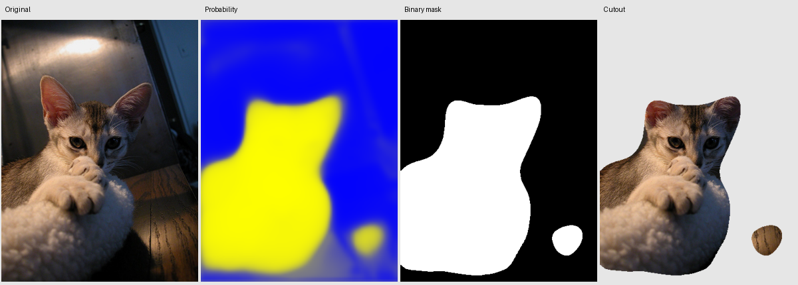

# Pet foreground segmentation

A PyTorch pipeline for separating cats and dogs from backgrounds: a handwritten
U-Net, a ResNet18 encoder U-Net, three masked losses, a central ellipse baseline,
locked Oxford-IIIT Pet splits, reproducible evaluation and a local upload demo.
The CLI exports original-size probabilities, a binary mask and a transparent PNG.

**Status:** the complete official dataset has passed audit, split manifests and
training-only statistics are saved, and **32 automated tests pass**. All six
models have been trained/evaluated in a one-epoch CPU pilot (128px). The combined
pretrained model achieves **0.840 mean IoU / 0.903 Dice** on 3,669 test images. See
[experiment status and protocol](reports/experiment-report.md).

**Accuracy study paused before shutdown:** 14 fine-tuning epochs at 256px are
saved, reaching 0.95617 validation IoU. New test evaluation is pending. See
[progress](PROGRESS.md) and [next-session instructions](NEXT_SESSION.md).

## Environment

Python 3.11–3.13 (tested with 3.13). From the repository root:

```bash
python3.13 -m venv .venv
source .venv/bin/activate
python -m pip install -e '.[dev]'
python -m pytest -q
petseg --help
```

Direct dependencies are pinned in `pyproject.toml`. The tested environment is
recorded in `requirements-lock.txt` for an exact transitive dependency snapshot.
For reproduction on Python 3.13, install it before the editable package
(other Python versions should resolve compatible transitive versions from pyproject.toml):

```bash
python -m pip install -r requirements-lock.txt
python -m pip install -e . --no-deps
```

PyTorch auto-selects CUDA, Apple MPS, then CPU. CUDA mixed precision is enabled
by config; CPU/MPS use float32. Seeds and deterministic CuDNN settings constrain
randomness but exact equality across accelerator types is not guaranteed.

## Data

```bash
petseg prepare --download --data-root data/oxford-pets --manifests data/manifests
petseg audit --data-root data/oxford-pets
```

Or extract both official archives manually before running `prepare` without
`--download`. See [DATA.md](DATA.md) for placement, citation, use terms, label
mapping, split rules and normalization. Data/checkpoints are excluded from Git.
The prepared manifests and statistics in `data/manifests/` lock 2,944 training,
736 validation and 3,669 test images. Preserve them in version control. The audit
fails on missing/corrupt masks, mismatched dimensions or unexpected trimap labels.

Value 3 is ignored in training and scoring; it is also used for letterbox padding.
Only train pixels determine mean/std. Paired flips/rotations are reproducible and
labels use nearest-neighbor interpolation. Validation/test transforms are fixed.

## Train and compare

```bash
petseg train --config configs/scratch-combined.yaml --output runs/scratch-combined
petseg train --config configs/pretrained-combined.yaml --output runs/pretrained-combined
petseg evaluate --output reports/generated/ellipse
petseg evaluate --checkpoint runs/scratch-combined/best.pt --output reports/generated/scratch-combined
petseg evaluate --checkpoint runs/pretrained-combined/best.pt --output reports/generated/pretrained-combined
petseg report reports/generated/ellipse reports/generated/scratch-combined reports/generated/pretrained-combined
```

The pretrained variant downloads torchvision's ImageNet ResNet18 encoder weights
on its first training run. Both variants use training-only normalization. Change
`loss` among `bce`, `dice`, `combined` through the six supplied configs. Change
optimizer, schedule, learning rate, batch size, size, seed, augmentation, epochs,
patience, device or AMP in YAML. Use a **fresh output directory** per run; existing
runs/results are protected against overwriting. Logs, config, audit and best/last
checkpoints are saved. Best means highest validation macro IoU at fixed threshold
0.5. Early stopping uses configured patience. Checkpoints include optimizer,
scheduler and scaler states for inspection; automatic training resume is not
implemented.

Run all six model/loss combinations plus the prior:

```bash
python scripts/run_experiments.py
# Short CPU pilot: one epoch, 128px, scratch base channels 16
python scripts/run_experiments.py --config-dir configs/pilot --runs-root runs/pilot --report-root reports/generated/pilot --device cpu
```

Pilot results are not a converged benchmark and must be kept separate from
the full 256px experiments. The test set is final reporting only. Do not tune experiments using earlier test
results. For blinded comparison, train all six configs before evaluating any.
Every result records split/statistics hash, checkpoint hash, parameter count,
input size, threshold, device and memory. Region scores are macro per-image;
`per_image.csv` retains the full distribution and breed. Summaries include
quantiles, standard deviation and foreground-size bins. Boundary F1 is separate,
at 2 resized pixels tolerance; ignored bands limit its coverage.

CPU and accelerator latency must be measured separately on available hardware:

```bash
petseg evaluate --checkpoint runs/scratch-combined/best.pt --device cpu --output reports/generated/scratch-cpu
# Use cuda or mps only on a machine with that accelerator:
petseg evaluate --checkpoint runs/scratch-combined/best.pt --device mps --output reports/generated/scratch-mps
```

| Pilot experiment (one epoch, 128px) | Mean IoU | Mean Dice |
|---|---:|---:|
| Central ellipse | 0.4762 | 0.6193 |
| Scratch · BCE | 0.5842 | 0.7207 |
| Scratch · Dice | 0.5970 | 0.7293 |
| Scratch · combined | 0.5975 | 0.7312 |
| ResNet18 U-Net · BCE | 0.8346 | 0.9001 |
| ResNet18 U-Net · Dice | 0.8147 | 0.8856 |
| ResNet18 U-Net · combined | **0.8402** | **0.9025** |

Pilot scratch base channels are 16 (1.96M parameters), versus 14.36M for the
pretrained variant. These are undertrained, unequal-capacity models, not an
isolated measurement of pretraining or a converged benchmark. Full 256px,
60-epoch experiments and repeated seeds have **not** been run. See the
[complete measurements](reports/pilot/results.md), [distributions](reports/pilot/results.png)
and [reviewed error gallery](reports/pilot/pretrained-combined/gallery.html).

Never substitute synthetic-test scores for this table. The generated comparison
in `reports/generated/results.md` contains actual measurements after evaluation,
along with `results.png` showing per-image IoU/Dice distributions.

## Cutouts and upload demo

The trained local pilot checkpoint is already available at
`runs/pilot/pretrained-combined/best.pt` (ignored by Git):

```bash
petseg demo --checkpoint runs/pilot/pretrained-combined/best.pt
petseg predict /path/to/pet.jpg --checkpoint runs/pilot/pretrained-combined/best.pt --output outputs/pet
```



The example uses `Abyssinian_10`, outside the training split; the stray retained
floor patch is a visible false positive. Attribution and modifications are
recorded in [assets/README.md](assets/README.md).

For a separately trained full-study checkpoint:

```bash
petseg predict /path/to/pet.jpg --checkpoint runs/pretrained-combined/best.pt --output outputs/pet
petseg demo --checkpoint runs/pretrained-combined/best.pt
```

Open [the local demo](http://127.0.0.1:7860). Upload a photograph, choose a threshold
and click **Remove background**. Original, probability heatmap, binary mask and
cutout appear side by side, with model version, threshold and inference time.
Download the PNG cutout, binary mask, 16-bit probability PNG or raw `.npy` array.
The server binds to localhost and does not create a public sharing link.

CLI output: `probability.npy` (float32 [0,1]), `probability.png` (16-bit),
`heatmap.png`, `mask.png` (8-bit 0/255), `cutout.png` (RGBA, binary alpha), and
`prediction.json` (model version/threshold/time). Predictions preserve aspect
ratio and restore the EXIF-oriented original dimensions. JPEG, PNG, WebP, BMP and
single-frame TIFF are supported; invalid/tiny/over-40-megapixel inputs fail clearly.

## Regenerate results and inspect errors

Evaluation stores compressed probabilities, targets, valid masks and resized
images per test ID under `predictions/`. Regenerate without model or dataset:

```bash
petseg report reports/generated/ellipse reports/generated/scratch-combined reports/generated/pretrained-combined --regenerate
petseg gallery reports/generated/scratch-combined
# A newline-delimited manifest can select identical curated IDs for every model:
petseg gallery reports/generated/scratch-combined --ids reports/gallery-ids.txt
```

The pilot has [20 reviewed examples](reports/pilot/pretrained-combined/gallery.html)
with [annotation/category notes](reports/gallery-review.csv). Open the evaluation's `gallery.html`. Its initial gallery is the 20 worst IoUs;
fill `gallery_tags.csv`, then curate examples to cover fur, tails, multiple pets,
similar-colored backgrounds, small pets and motion blur. Review whether all
animals are annotated before calling multi-pet differences model failures.
Keep small reviewed/attributed examples in `assets/`; large generated artifacts
stay ignored. [The report](reports/experiment-report.md) describes remaining review.

## Architecture

All conv blocks are two padded 3×3 convolutions with GroupNorm and ReLU. The scratch
encoder has channels **32, 64, 128, 256, 512**, max pooling by 2 between levels;
bilinear upsampling concatenates skip features and halves channels on the way up.
A 1×1 head returns logits. GroupNorm permits small batches. Skip-target resizing
handles odd spatial dimensions without a crop or loss of output pixels.

| Stage (256×256 RGB input) | Scratch | ResNet18 encoder variant |
|---|---|---|
| Full resolution | 32 × 256 × 256 | extra 32 × 256 × 256 skip |
| Stem | 64 × 128 × 128 | 64 × 128 × 128 |
| Down 2 | 128 × 64 × 64 | 64 × 64 × 64 |
| Down 3 | 256 × 32 × 32 | 128 × 32 × 32 |
| Down 4 | 512 × 16 × 16 | 256 × 16 × 16 |
| Encoder bottleneck | same as Down 4 | 512 × 8 × 8 |
| Decoder channels | 256, 128, 64, 32 | 256, 128, 64, 32, 32 |
| Output | 1 × 256 × 256 logits | 1 × 256 × 256 logits |

The ResNet18 encoder comes from torchvision; the decoder is implemented here.
It is initialized with `ResNet18_Weights.IMAGENET1K_V1`; no pretrained segmentation
head is used. Default parameter counts are **7,849,601** (scratch) and **14,359,105** (ResNet18 U-Net), also recorded by the evaluator. A sigmoid creates
probabilities. Masked BCE and smoothed per-image soft Dice support empty
foreground and all-ignored masks. Combined loss averages them equally.

## Limits and licensing

**Images without a pet may produce false positives.** Training covers the Oxford
cats/dogs distribution, not general salient objects. Binary alpha does not model
translucent fur; thin tails, similar backgrounds, small subjects and motion blur
need visual review. Multiple visible animals may not all be annotated. Border
exclusion makes reported region accuracy more forgiving than fine cutout quality.
Threshold adjustment in the demo is not evidence of a better held-out score.

Code: [MIT](LICENSE). Dataset and derived pet examples: see [DATA.md](DATA.md).
No weights have been published; the commands above reproduce training. If weights
are released, record an immutable URL, SHA-256, associated config and split hash
before claiming a downloadable pretrained background-removal tool.
