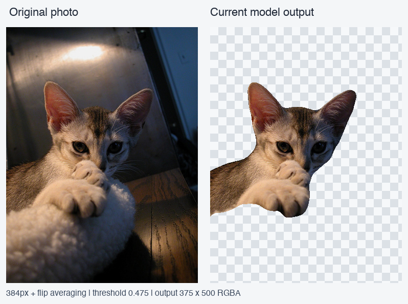
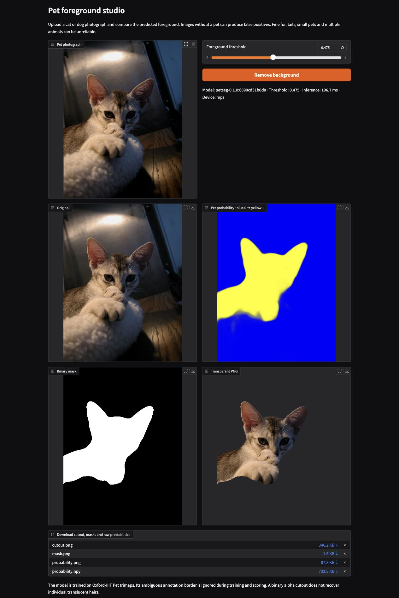

# Pet foreground segmentation

Separate cats and dogs from their backgrounds with a PyTorch U-Net and a local
upload demo. The project includes a handwritten U-Net, a ResNet18 encoder variant,
masked losses, reproducible training and original-size transparent PNG exports.

The completed accuracy study achieved **96.76% mean foreground IoU / 98.05% Dice**
on all **3,669 official Oxford-IIIT Pet test images**, scored at original annotation
resolution. The model and inference settings were selected using validation only.

| Original-resolution test benchmark | Mean IoU | Mean Dice |
|---|---:|---:|
| One-epoch pretrained pilot | 0.8403 | 0.9026 |
| Selected model: 384px + flip averaging | **0.9676** | **0.9805** |

The selected system uses a **0.475 threshold** and averages ordinary and
horizontally flipped predictions. Both rows use identical test IDs and ignored-pixel
rules. These are repeated public benchmark measurements; the test was already
inspected during the pilot. **33 automated tests pass.** See the
[full accuracy report](reports/accuracy-improvement.md),
[measurement files](reports/accuracy/README.md) and
[training curves](reports/accuracy/training.png).

## Current demo example



This is validation photo `Abyssinian_10`, freshly processed with the selected model
`6690cd31b0d0`, 384px input, flip averaging and threshold 0.475. The right panel
shows the **current model only**; its checkerboard illustrates transparency.
The [exported cutout](assets/accuracy/readme-cat-cutout.png) is a **375×500 RGBA PNG**,
with the same dimensions as the original photograph. Fine hair remains approximate.
[Example provenance](assets/accuracy/readme-cat-example.json) and
[image attribution](assets/README.md) are saved alongside it. The
[historical original/pilot/selected comparison](assets/accuracy/example-comparison.png)
is retained separately.

## Setup and weights

Python 3.11–3.13 is supported; the tested environment uses Python 3.13. From the
repository root:

```bash
python3.13 -m venv .venv
source .venv/bin/activate
python -m pip install -e '.[dev]'
python -m pytest -q
petseg --help
```

Direct dependencies are pinned in `pyproject.toml`. For the exact tested Python
3.13 dependency versions, install `requirements-lock.txt` before the editable package:

```bash
python -m pip install -r requirements-lock.txt
python -m pip install -e . --no-deps
```

**Model weights are not included in this GitHub repository and have not been
published for download.** On the original project machine, the completed model is
at `runs/accuracy/selected.pt`. A fresh clone needs that checkpoint copied from an
existing run or recreated through the training workflow below before prediction
or the demo can run. Datasets, checkpoints, environments and full generated
predictions are excluded from Git; small result snapshots and examples are committed.

PyTorch auto-selects CUDA, Apple MPS, then CPU. CUDA mixed precision is configurable;
CPU/MPS use float32. Seeds constrain randomness, but exact equality across hardware
and training runs is not guaranteed.

## Run the selected model

Once `runs/accuracy/selected.pt` is present:

```bash
petseg demo --checkpoint runs/accuracy/selected.pt
petseg predict /path/to/pet.jpg --checkpoint runs/accuracy/selected.pt --output outputs/pet
```

Open [the local demo](http://127.0.0.1:7860/), upload a photograph and click
**Remove background**. The checkpoint automatically supplies the 384px input size,
flip averaging and 0.475 threshold. The threshold control can be adjusted for an
individual cutout. Original, probability, binary mask and cutout appear with model
version and inference time. Download the PNG cutout, mask, 16-bit probability PNG
or raw probabilities. The server binds to localhost without a public sharing link.

<details>
<summary>Verified demo screenshot using the selected model</summary>



The browser upload and actual PNG download were verified using `Abyssinian_10`;
see [verification details](reports/accuracy/browser-verification.json).

</details>

CLI output files are `probability.npy` (float32), `probability.png` (16-bit),
`heatmap.png`, `mask.png` (0/255), `cutout.png` (RGBA, binary alpha), and
`prediction.json` (version, threshold, time). Predictions preserve aspect ratio
and restore EXIF-oriented original dimensions. JPEG, PNG, WebP, BMP and single-frame
TIFF are supported; invalid, tiny or over-40-megapixel inputs fail clearly.

On the same 50 validation photos, after three warmups, the selected prediction
pipeline averaged **210.98 ms on CPU** (four threads) and **52.63 ms on Apple MPS**.
This includes preprocessing, model passes, CPU transfer, inverse resizing and output
construction, after file decoding; it excludes model loading, exports and browser
upload overhead. Raw timing evidence and scope are in the [accuracy report](reports/accuracy-improvement.md).

## Data

```bash
petseg prepare --download --data-root data/oxford-pets --manifests data/manifests
petseg audit --data-root data/oxford-pets
```

Alternatively, extract both official archives before running `prepare` without
`--download`. [DATA.md](DATA.md) records placement, citation, terms, label mapping,
split rules and normalization. The committed manifests lock **2,944 training /
736 validation / 3,669 test images**, with seed 42. Existing complete manifests are
verified rather than silently replaced. The full official dataset passed audit;
missing/corrupt pairs, mismatched dimensions or unexpected labels fail the check.

Trimap labels are **1 foreground / 2 background / 3 ignored**. Label 3 and letterbox
padding are excluded from loss and metric denominators. Normalization uses training
pixels only. Paired image/mask transforms remain aligned; label resizing uses nearest
neighbor interpolation. Validation/test transforms are deterministic.

## Reproduce the accuracy study

The completed study starts from the one-epoch pretrained-combined pilot, fine-tunes
for **30 epochs at 256px**, then refines for **eight epochs at 384px**. Best epochs
were 27 and 6 respectively. All model selection uses validation; test evaluation
follows selection.

Run the following only for a new reproduction with fresh output paths. Existing
run directories and evaluation results are protected from overwriting. The accuracy
configs target Apple MPS; change `device` in the YAMLs for CPU or CUDA hardware.
Also replace `--device mps` in the calibration/evaluation commands with `cpu` or
`cuda` as appropriate. The first pretrained run downloads torchvision's ImageNet
ResNet18 encoder weights.

```bash
petseg train --config configs/pilot/pretrained-combined.yaml --output runs/pilot/pretrained-combined
petseg train --config configs/accuracy/finetune-256.yaml --output runs/accuracy/finetune-256
petseg train --config configs/accuracy/refine-384.yaml --output runs/accuracy/refine-384
petseg calibrate --checkpoint runs/accuracy/finetune-256/best.pt --sizes 256 384 512 --device mps --output runs/accuracy/finetune-256/calibration.json --export runs/accuracy/finetune-256/calibrated.pt
petseg calibrate --checkpoint runs/accuracy/refine-384/best.pt --sizes 256 384 512 --device mps --output runs/accuracy/refine-384/calibration.json --export runs/accuracy/refine-384/calibrated.pt
```

Calibration scores all 736 validation images on their original annotation grid,
comparing input sizes 256/384/512, with/without flip averaging and 25 thresholds
from 0.2 to 0.8. Freeze the candidate with highest native-grid validation IoU:

```python
import json
import shutil
from pathlib import Path

stages = [Path("runs/accuracy/finetune-256"), Path("runs/accuracy/refine-384")]

def validation_iou(stage):
    report = json.loads((stage / "calibration.json").read_text())
    return report["selected"]["mean_iou"]

winner = max(stages, key=validation_iou)
target = Path("runs/accuracy/selected.pt")
if target.exists():
    raise FileExistsError("Preserve the existing selected checkpoint; choose a new path.")
shutil.copy2(winner / "calibrated.pt", target)
print("Selected from validation:", winner)
```

In the measured study, the refined model won: **0.969807 validation IoU / 0.983243
Dice**, using 384px, flip averaging and threshold 0.475. The completed 256px candidate
scored 0.967241 native validation IoU. The [selection record](reports/accuracy/selection.json)
was committed before new test evaluation. The exported checkpoint stores the
selected inference settings and provenance.

Evaluate the frozen winner and pilot on the **same original-resolution grid**:

```bash
petseg evaluate --checkpoint runs/pilot/pretrained-combined/best.pt --native --device mps --output reports/generated/accuracy/pilot-native
petseg evaluate --checkpoint runs/accuracy/selected.pt --native --device mps --output reports/generated/accuracy/selected-native
petseg report reports/generated/accuracy/pilot-native reports/generated/accuracy/selected-native --output reports/generated/accuracy/results.md
```

Training supports configurable loss, optimizer, schedule, learning rate, batch size,
resolution, seed, augmentation, early stopping and AMP. Separate encoder/decoder
learning rates are used in this study. Each epoch saves config/history and atomic
best/last checkpoints; training-stage best means highest validation macro IoU at
threshold 0.5. Calibration then selects the inference policy.

**Resume is implemented.** Continue an interrupted run using the same config/output:

```bash
petseg train --config configs/accuracy/finetune-256.yaml --output runs/accuracy/finetune-256 --resume
```

This restores model, optimizer, scheduler and scaler, validates config/data contract,
appends history and continues the original epoch budget. New checkpoints save RNG
and loader state. The historical epoch-14 checkpoint predates RNG-state saving, so
exact random-sequence continuity across that old pause cannot be recovered. See the
[training report](reports/accuracy-improvement.md) for the recorded resume history.

## Original model/loss pilot

The earlier experiment trained all six combinations for one epoch at 128px before
test evaluation. This table uses the **128px input grid**, rather than the native
grid of the headline comparison above:

| Pilot experiment | Mean IoU | Mean Dice |
|---|---:|---:|
| Central ellipse | 0.4762 | 0.6193 |
| Scratch · BCE | 0.5842 | 0.7207 |
| Scratch · Dice | 0.5970 | 0.7293 |
| Scratch · combined | 0.5975 | 0.7312 |
| ResNet18 U-Net · BCE | 0.8346 | 0.9001 |
| ResNet18 U-Net · Dice | 0.8147 | 0.8856 |
| ResNet18 U-Net · combined | 0.8402 | 0.9025 |

Pilot scratch models use base channels 16 (1.96M parameters), versus 14.36M for the
pretrained variant. These are undertrained, unequal-capacity comparisons; the full
six-config 60-epoch study and repeated seeds have not been run. Historical results,
figures and examples remain in the [pilot report](reports/experiment-report.md).
To reproduce the short matrix into separate fresh directories:

```bash
python scripts/run_experiments.py --config-dir configs/pilot --runs-root runs/pilot-matrix --report-root reports/generated/pilot-matrix --device cpu
```

The six full-length configs remain under `configs/`; loss choices are BCE, Dice
and their equally weighted combination. All three exclude ignored pixels.

## Regenerate results and inspect errors

Rebuild the final table, distribution figure, paired bootstrap and breed comparison
from small committed metric snapshots, without weights or the dataset:

```bash
python scripts/compare_accuracy.py reports/accuracy/pilot-native reports/accuracy/selected-native --output outputs/accuracy-report
```

Full saved probabilities, targets, valid masks and images are under the ignored
`reports/generated/accuracy/` directories on the original project machine. With
those arrays present, recompute pixel metrics without loading weights or the dataset:

```bash
petseg report reports/generated/accuracy/pilot-native reports/generated/accuracy/selected-native --regenerate --output outputs/regenerated-accuracy/results.md
petseg gallery reports/generated/accuracy/selected-native --ids reports/gallery-ids.txt
```

Do not run `--regenerate` on the small committed snapshots; they contain metric
CSVs and selected panels, rather than full probability arrays. The selected model's
[20 reviewed examples](reports/accuracy/selected-native/gallery.html) cover fur,
tails, multiple animals, similar backgrounds, small pets and possible motion blur.
[Per-example comparisons](reports/accuracy/reviewed-comparison.csv) record gains,
regressions and annotation coverage. Download/open `gallery.html` locally to view
its panels; GitHub displays HTML as source.

The selected model improved IoU on **3,491 images**, tied eight and worsened on
**170**. Small-pet mean IoU rose from **0.7362 to 0.9496**, but failures remain:
`chihuahua_82` loses much of its body and `pomeranian_93` retains framed background.
The [full report](reports/accuracy-improvement.md) discusses these cases, paired
uncertainty, score distributions and the speed/quality tradeoff.

## Architecture

The handwritten convolution blocks contain two padded 3×3 convolutions with
GroupNorm and ReLU. The scratch encoder has channels **32, 64, 128, 256, 512**, with
max pooling by 2 between levels. Bilinear upsampling concatenates skip features;
a 1×1 head returns logits. The torchvision ResNet18 encoder retains its own
BatchNorm layers; its decoder and additional full-resolution skip are implemented
here. Skip-target resizing supports odd spatial dimensions.

| Stage (256×256 RGB input) | Scratch | ResNet18 encoder variant |
|---|---|---|
| Full resolution | 32 × 256 × 256 | extra 32 × 256 × 256 skip |
| Stem | 64 × 128 × 128 | 64 × 128 × 128 |
| Down 2 | 128 × 64 × 64 | 64 × 64 × 64 |
| Down 3 | 256 × 32 × 32 | 128 × 32 × 32 |
| Down 4 | 512 × 16 × 16 | 256 × 16 × 16 |
| Encoder bottleneck | same as Down 4 | 512 × 8 × 8 |
| Decoder channels | 256, 128, 64, 32 | 256, 128, 64, 32, 32 |
| Output | 1 × 256 × 256 logits | 1 × 256 × 256 logits |

Default parameter counts are **7,849,601** for scratch and **14,359,105** for
ResNet18 U-Net. The encoder starts from `ResNet18_Weights.IMAGENET1K_V1`; no
pretrained segmentation head is used. Both variants use the same training-derived
normalization. Masked BCE and smoothed per-image Dice handle empty foreground and
all-ignored masks. A sigmoid produces probabilities.

## Limits and licensing

**Images without a pet may produce false positives.** Training covers Oxford
cats/dogs rather than general salient objects. Binary alpha does not recover
translucent fur. Ignored trimap contours make region scores more forgiving than
fine cutout quality; a perfect region IoU does not establish perfect hair edges.
Boundary F1 is reported separately at two pixels on the evaluation grid (original
pixels for the final study); ignored neighborhoods limit its contour coverage.
Multiple visible animals may not all be annotated. Demo threshold adjustment is
for individual cutouts and does not establish a better benchmark score.

The review found seven all-background test masks despite visible pets and one
apparently inverted mask. **All remain in the reported 3,669-image scores**; see
[annotation review](reports/accuracy/annotation-review.csv). Test results are
reporting evidence and must not guide further threshold/model tuning. The measured
improvement over the pilot does not establish an accuracy ceiling or training-seed
stability.

Code: [MIT](LICENSE). Dataset and derived pet examples: [DATA.md](DATA.md) and
[asset attribution](assets/README.md). Weights remain local and unpublished; any
future distribution should identify the exact checkpoint, config and split contract.
